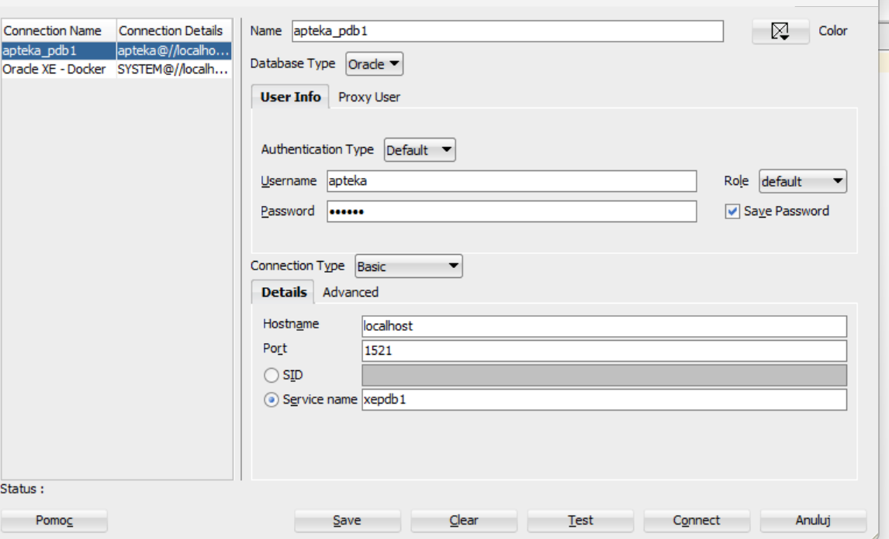
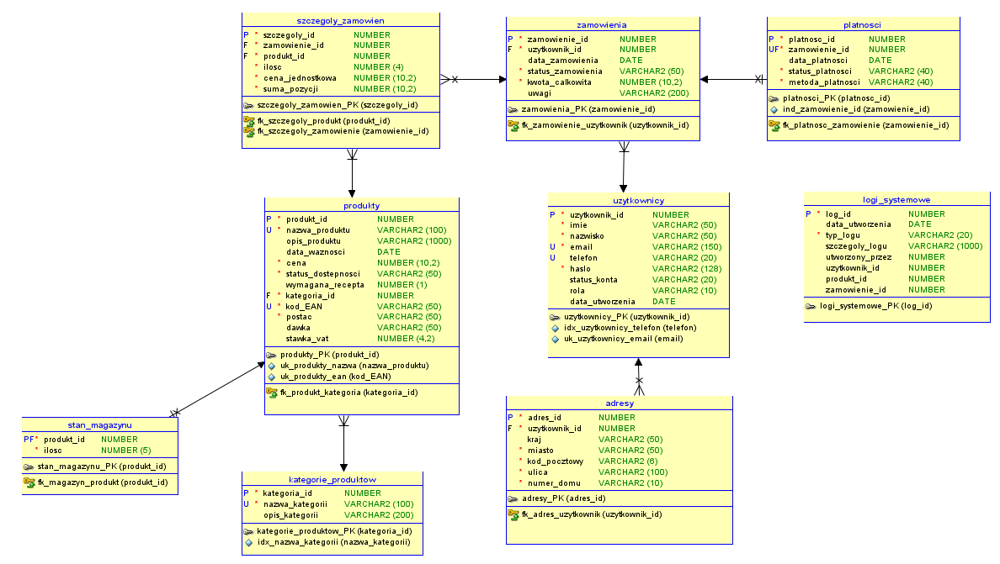
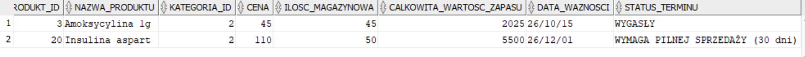
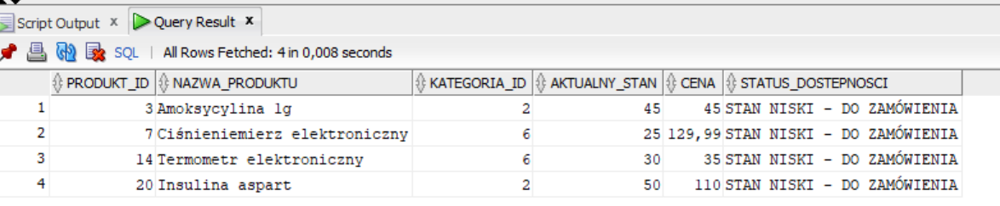
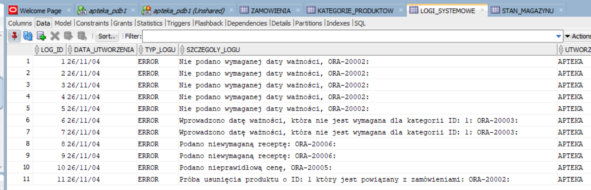
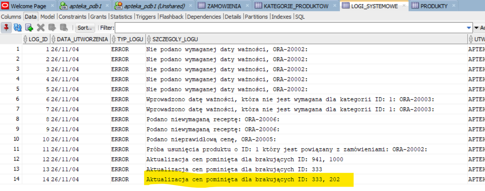
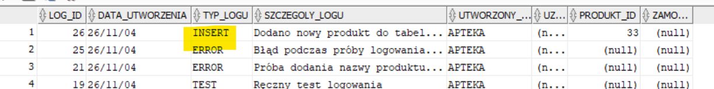
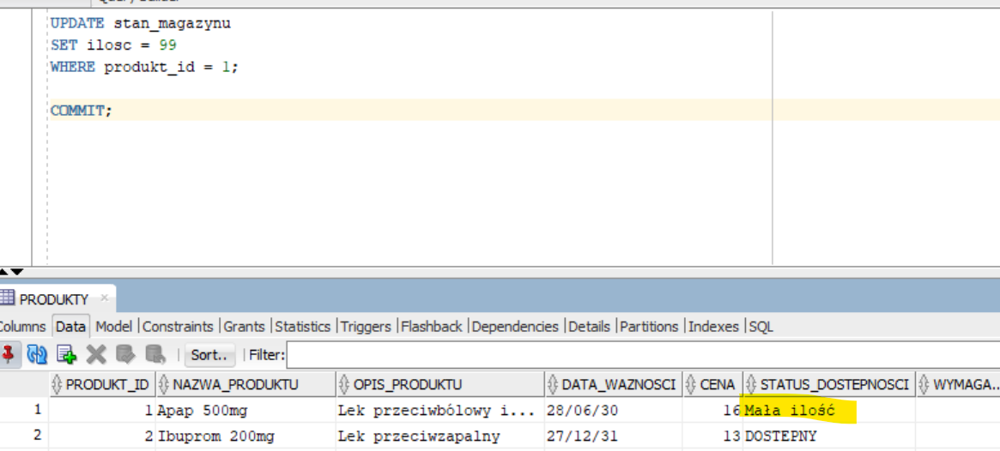

# Relacyjna Baza Danych Apteki | SQL & PL/SQL


<br>
 Cześć!,

 dziękuję że odwiedzasz moje repozytorium! Zapraszam cię do zapoznania się z moim projektem. <br>

*Autorski projekt bazy danych SQL apteki oparty na silniku Oracle.*
<br>
*Obejmujący  modelowanie ERD do normalizacji tabel 3NF, skrypty DDL/DML oraz logikę napisaną w PL/SQL*
<br>
<br>

(*Stworzony z myślą o dalszej rozbudowie*)
<br>

---

### Szybki nawigator po projekcie:

<br>
<div align="center">

<a href="./dokumentacja/diagram_erd.png"></a>
&nbsp;&nbsp;&nbsp;
<a href="./skrypty_sql/apteka_schemat.ddl"></a>
&nbsp;&nbsp;&nbsp;
<a href="./skrypty_sql/procedury"></a>
&nbsp;&nbsp;&nbsp;
<a href="./skrypty_sql/wyzwalacze"></a>

</div>
<br>

### 📚 Spis treści
<div id="1-Cel projektu"></div>
<details>
<summary><b>1. Cel projektu</b></summary>
<br>

<p>
Zaprojektowanie i wdrożenie relacyjnej bazy danych dla apteki.<br>
W ramach architektury kluczowa logika biznesowa została przeniesiona bezpośrednio do warstwy bazy danych Oracle (PL/SQL), co pozwoliło zrealizować następujące założenia:<br>

<b>1. Zestaw dedykowanych widoków SQL ułatwiających pracownikom szybki wgląd w kluczowe dane magazynowe i sprzedażowe.</b><br><br>
<b>2. Procedury PL/SQL do bezpiecznego dodawania i usuwania produktów oraz aktualizacji cen, połączone z automatycznym logowaniem zmian.</b><br><br>
<b>3. System audytu: Dedykowana tabela logów oraz procedury rejestrujące kluczowe operacje i zmiany w systemie.</b><br><br>
<b>4. Wyzwalacz: Mechanizm dynamicznie analizujący stany magazynowe i aktualizujący status dostępności produktów w czasie rzeczywistym. </b><br><br>
</p>

<br>
<br>
<br>


</details>

<div id="2-Wymagania wstepne i narzedzia"></div>
<details>
  
<summary><b> 2. Wymagania wstępne</b> <i></i></summary>
<br>
Do uruchomienia oraz analizy projektu wymagany jest <br>
* silnik bazy danych Oracle Database (zalecana wersja 18c / 21c lub starsza, np. 11g)<br>
* narzędzia do zarządzania obiektami bazy.
<br>
<br>
W projekcie wykorzystano:
<br>
<br>

&emsp; 1. Środowisko Uruchomieniowe (Engine)

* **Oracle Database 21c Express Edition** (Release 21.0.0.0.0 - Production) – główny silnik bazodanowy.
* **Docker Desktop (WSL2 na Windows 11)** – użyty do konteneryzacji silnika bazy danych. *Użycie Dockera nie jest obligatoryjne (serwer można zainstalować bezpośrednio na systemie operacyjnym), jednak kontener izoluje środowisko i znacznie ułatwia proces wdrażania.*

&emsp; 2. Narzędzia Klienta & Projektowe

* **Oracle SQL Developer** – do nawiązywania połączeń z bazą, wykonywania skryptów DDL/DML oraz tworzenia i debugowania obiektów PL/SQL (procedury, funkcje, wyzwalacze).
* **Oracle SQL Developer Data Modeler** – do projektowania schematów oraz edycji plików źródłowych diagramu ERD.

<br>
<br>
<br>
<br>

</details>

<div id="3-Konfiguracja połaczenia z serwerem"></div>
<details>
<summary><b> 3. Inicjalizacja środowiska i instalacja struktur bazodanowych </b> <i></i></summary>

<br>

### Konfiguracja bazy danych i uprawnień

&emsp; 1. Przed uruchomieniem skryptu DDL należy utworzyć dedykowanego użytkownika (schemat) w bazie Oracle oraz nadać mu odpowiednie uprawnienia. <br>
Wykonaj poniższe polecenia jako administrator (np. jako użytkownik `SYS` lub `SYSTEM` w kontenerze `XEPDB1`):

```sql
-- 1. Utworzenie użytkownika bazy danych
CREATE USER apteka IDENTIFIED BY Haslo1234;

-- 2. Nadanie podstawowych ról do połączenia i tworzenia obiektów
GRANT CONNECT, RESOURCE TO apteka;

-- 3. Nadanie uprawnień do tworzenia procedur i funkcji PL/SQL
GRANT CREATE PROCEDURE TO apteka;

-- 4. Przyznanie nielimitowanego miejsca na przestrzeni tabel (tablespace) USERS
ALTER USER apteka QUOTA UNLIMITED ON USERS;
-- 5. Przyznanie uprawnień do tworzenia widoków
GRANT CREATE VIEW TO apteka;
```

&emsp; 2. Poniższy zrzut przedstawia poprawne ustawienia połączenia z kontenerem PDB w SQL Developerze:

<p align="center">
  
</p>

&emsp; 3. Uruchomienie skryptu DDL (Utworzenie struktur bazy)
   
<br>

Po pomyślnym skonfigurowaniu połączenia z bazą w SQL Developerze (`apteka_pdb`), należy wykonać skrypt tworzący tabele, relacje oraz ograniczenia biznesowe.

<br>

Otwórz nowe okno SQL Worksheet dla połączenia apteka_pdb w SQL Developerze, wklej tam zawartość pliku ze skryptem DDL i uruchom go za pomocą skrótu F5.
<br>
Plik znajduje się w repozytorium pod nazwą `apteka_schemat_ddl`.


<br>
<br>
<br>
<br>
</details>

<div id="4-Projektowanie"></div>
<details>
<summary><b> 4. Projektowanie i architektura bazy danych (model logiczny) </b></summary>
<br>

<details>
<summary><b>4.1. Założenia biznesowe </b></summary>
<p>
    
W ujęciu biznesowym system bazy danych apteki odwzorowuje standardowy proces e-commerce.
W modelu koncepcyjnym wyodrębniono następujące powiązania między obiektami:

* **`uzytkownicy` i `adresy`** – Klient rejestruje się w systemie i może zarządzać wieloma adresami dostawy.
* **`kategorie_produktow` i `produkty`** – Asortyment apteki jest podzielony na kategorie, a każdy produkt należy do jednej z nich.
* **`stan_magazynu`** – Reprezentuje bieżącą dostępność ilościową poszczególnych produktów.
* **`zamowienia` oraz `szczegoly_zamowien`** – Klient składa zamówienia; każde zamówienie składa się z jednej lub wielu pozycji (produktów w określonych ilościach i cenach).
* **`platnosci`** – Każde zamówienie powiązane jest z transakcją odnotowującą status i metodę płatności.
  
 &nbsp;&nbsp;&nbsp;&nbsp; </details>

  <details>
  &emsp;  <summary><b>4.2. Model logiczny (diagram ERD, normalizacja do Trzeciej Postaci Normalnej) </b></summary>
  <p>
  Projekt opiera się na relacyjnym modelu bazy danych, w którym kluczową rolę odgrywa tabela łącznikowa `szczegoly_zamowien`, rozwiązująca relację wiele do wielu (M:N) <br>
  pomiędzy zamówieniami a produktami.
   
  ### Kardynalność i relacje:
  * **`uzytkownicy` (1) ──do──> (N) `adresy`** – jeden użytkownik może posiadać wiele adresów (relacja 1:N z kaskadowym usuwaniem).
  * **`kategorie_produktow` (1) ──do──> (N) `produkty`** – w jednej kategorii znajduje się wiele produktów.
  * **`produkty` (1) ──do──> (1) `stan_magazynu`** – każdy produkt ma dokładnie jeden wpis określający jego stan magazynowy.
  * **`uzytkownicy` (1) ──do──> (N) `zamowienia`** – użytkownik może składać wiele zamówień.
  * **`zamowienia` (1) ──do──> (N) `szczegoly_zamowien`** – zamówienie składa się z wielu pozycji.
  * **`produkty` (1) ──do──> (N) `szczegoly_zamowien`** – produkt może występować w wielu pozycjach różnych zamówie.
  * **`zamowienia` (1) ──do──> (1) `platnosci`** – każdemu zamówieniu odpowiada jedna płatność.
  * **`logi_systemowe`** – tabela audytowa rejestrująca zdarzenia w systemie. <br>
    
  Diagram ERD utworzony w narzędziu SQL Data Modeler.

  <p align="center">
  
  </p>

  ### Normalizacja schematu (3NF)
  <br>
  Zaprojektowany schemat bazy danych spełnia zasady Trzeciej Postaci Normalnej (3NF)
  <br>
  
 ### Jak znormalizowano kluczowe tabele?

  * **1. Rozdzielenie użytkowników od adresów (`uzytkownicy` ──> `adresy`)**

  Dane adresowe wyciągnięto do osobnej tabeli, co zapobiega dublowaniu lokalizacji i pozwala jednemu użytkownikowi posiadać wiele adresów (relacja 1:N) bez powielania danych osobowych.

  * **2. Katalogowanie produktów (`kategorie_produktow` ──> `produkty`)**
    
  Nazwa i opis kategorii zależą wyłącznie od klucza kategorii (`kategoria_id`), a nie od konkretnego leku.<br>
  Dzięki wydzieleniu słownika opis kategorii nie powtarza się przy każdym produkcie.

  * **3. Historia cen transakcyjnych (`szczegoly_zamowien`)**
    
  Tabela łącznikowa przechowuje własną `cena_jednostkowa` oraz `ilosc` z momentu zakupu.<br>
  Odcina to zależność od dynamicznej ceny w tabeli `produkty` – cena na zamówieniu jest atrybutem historycznym konkretnej transakcji.

  * **4. Izolacja stanu magazynowego (`stan_magazynu` ──> `produkty`)**
    
  Dane katalogowe leku (opis, nazwa) zmieniają się rzadko, podczas gdy stan magazynowy (liczba sztuk) ulega stałym zmianom przy sprzedaży.<br>
  Wydzielenie tej relacji odciąża główny słownik produktów i rozdziela dane statyczne od operacyjnych.
     
  &nbsp;&nbsp;&nbsp;&nbsp;
  </p>
  </details>

  <details>
  <summary><b>4.3. Model fizyczny</b></summary>
  
  Kod źródłowy znajduje się w katalogu `skrypy_sql/apteka_schemat.ddl`

  👉 [Kliknij tutaj, aby przejrzeć pełny kod DDL](./skrypty_sql/apteka_schemat.ddl)
  
  <br>

  Przykładowy DDL
  
  ```sql
  CREATE TABLE szczegoly_zamowien (
      szczegoly_id       NUMBER GENERATED BY DEFAULT AS IDENTITY PRIMARY KEY,
      zamowienie_id     NUMBER NOT NULL,
      produkt_id        NUMBER NOT NULL,
      ilosc             NUMBER(5) NOT NULL CHECK (ilosc > 0),
      cena_jednostkowa  NUMBER(10, 2) NOT NULL
  );
  ```
    
  </details>
  <br>
<br><br>
<br>

</details>

<div id="5-implementacja-logiki-biznesowej"></div>
<details>
<summary><b>5. Kluczowe funkcjonalności i implementacja PL/SQL</b></summary>
<br>
  
### DANE TESTOWE

Aby ułatwić testowanie mechanizmów bazy danych, przygotowałem dedykowany zestaw danych testowych.

👉 [Dane testowe](./skrypty_sql/apteka_dane_testowe.sql)

---


W warstwie bazy danych zastosowano zróżnicowane mechanizmy ochrony i logiki. Oto najważniejsze z nich, które zostały wdrożone na tym etapie.


<details>
<summary><b>5.1. Więzy integralności (Constraints & CHECK)</b></summary>
<br>
<br>

- <b>Ograniczenia wartości (<code>CHECK</code>):</b> Weryfikacja dodatnich ilości produktów, cen oraz dopuszczalnych statusów zamówień bezpośrednio w tabelach.
- <b>Klucze i relacje (<code>PRIMARY KEY</code>, <code>FOREIGN KEY</code>):</b> Gwarancja unikalności rekordów i spójności  z regułami usuwania (np. <code>ON DELETE CASCADE</code> lub <code>SET NULL</code>).

Przykłady
<br>
```sql
ALTER TABLE szczegoly_zamowien 
ADD CONSTRAINT chk_ilosc CHECK (ilosc > 0);
```
<br>

```sql
ALTER TABLE stan_magazynu 
    ADD CONSTRAINT fk_magazyn_produkt FOREIGN KEY 
    ( 
     produkt_id
    ) 
    REFERENCES produkty 
    ( 
     produkt_id
    ) 
    ON DELETE CASCADE 
    NOT DEFERRABLE 
;

```
<br>
</details>

<details>
<summary><b>5.2. Widoki i programy PL/SQL</b></summary>
<br>

W projekcie zaimplementowano kilka mechanizmów bazodanowych.<br><br>*W pliku sql znajdują się komentarze z opisem działania kodu*  <br>

**WIDOKI**

  1. `v_produkty_z_magazynu` [(Zobacz kod)](./skrypty_sql/v_produkty_z_magazynu.sql) <br><br>
  Widok agregujący dane asortymentowe wraz z bieżącymi stanami magazynowymi dla poszczególnych produktów. <br>
  <br>
  <br>

   2. `v_analiza_magazynowa` [(Zobacz kod)](./skrypty_sql/v_analiza_magazynowa.sql) <br><br>
  Widok łączy dane produktów z ich aktualnymi stanami magazynowymi.
  Automatycznie oblicza całkowitą wartość finansową towaru na półkach (cena × ilość) i kontroluje daty ważności.
  <br>
  
   <p align="center">
  
  </p>

   3. `v_produkty_krytyczny_stan` [(Zobacz kod)](./skrypty_sql/v_produkty_krytyczny_stan.sql) <br><br>
  Widok prezentuje, które leki lub produkty kończą się na półkach i wymagają ponownego zamówienia u dostawcy.
  <br>

   <p align="center">
  
  </p>


**PROCEDURY**

  1. `p_dodaj_produkt` [(Zobacz kod)](./skrypty_sql/procedury/p_dodaj_produkt.sql) <br><br>
  Weryfikuje poprawność danych nowego produktu (m.in. kategorię, datę ważności, receptę i cenę), bezpiecznie zapisuje go w tabeli asortymentu, a wszelkie napotkane błędy i wyjątki                automatycznie rejestruje w tabeli logów systemowych (uruchamia procedurę **p_logowanie_zdarzeń**) <br>
  <br>
  <br>
  
  2. `p_logowanie_zdarzen` [(Zobacz kod)](./skrypty_sql/procedury/p_logowanie_zdarzen.sql) <br><br>
  Jest to procedura autonomiczna (PRAGMA AUTONOMOUS_TRANSACTION), która rejestruje zdarzenia systemowe, błędy i wyjątki w dedykowanej tabeli logów, zapisując typ zdarzenia oraz szczegółowy       komunikat.
  <br>
  <br>
  
  3. `p_usun_produkt` [(Zobacz kod)](./skrypty_sql/procedury/p_usun_produkt.sql) <br><br>
  Procedura uniemożliwia skasowanie produkt, który znajduje się na stanie magazynowym lub w historii zamówień.<br>W razie próby naruszenia tych zasad, automatycznie blokuje operację i zapisuje   szczegółowy błąd w dzienniku logów.
  <br>
    <p align="center">
  
  </p>
  <br>
  <br>

  4. `p_aktualizuj_ceny_produktow` [(Zobacz kod)](./skrypty_sql/procedury/p_aktualizuj_ceny_produktow.sql) <br><br>
  To procedura służąca do masowej aktualizacji cen produktów przy użyciu kolekcji.<br>Zamiast modyfikować ceny pojedynczo w pętli, przekazuje całe tablice identyfikatorów oraz odpowiadających
  im nowych cen w jednej operacji wsadowej.<br>Kluczowe znaczenie ma tutaj operator *FORALL*, który zapewnia maksymalną wydajność bazy danych.<br><br>
  Procedura przeprowadza walidacje: 
  * Sprawdza, czy obie tablice mają dokładnie taki sam rozmiar (tyle samo ID, co nowych cen).  <br>
  * Sprawdza, czy żadna z przekazanych cen nie jest ujemna.  <br>
  * Sprawdza w pętli, czy wszystkie podane produkty istnieją w bazie – w przypadku wykrycia brakujących ID przerywa operację, loguje błąd i zwraca czytelny komunikat.<br>
  <br>
  Obsługa wyjątków i autonomiczne logowanie błędów w procedurze masowej aktualizacji cen.
    <p align="center">
  
  </p>
  
  **WYZWALACZE**

  1. `trg_po_zmianach_produkty` [(Zobacz kod)](./skrypty_sql/wyzwalacze/trg_po_zmianach_produkty.sql) <br><br>
  To klasyczny wyzwalacz rejestrujący historie zmian (audit trail). Trigger uruchamia się po każdej operacji INSERT, UPDATE lub DELETE dla każdego zmienianego wiersza.
  Jego zadaniem jest rozpoznanie typu operacji, pobranie odpowiedniego ID oraz przekazanie tych danych do autonomicznej procedury logującej, która zapisuje historię w tabeli `logi_systemowe`
  <br>
    Zapis w tabeli logów  <br>
  <p align="center">
  
  </p>
  <br>
  <br>

   2. `trg_po_aktualizacji_stan_magazyn` [(Zobacz kod)](./skrypty_sql/wyzwalacze/trg_po_aktualizacji_stan_magazyn.sql) <br><br>
  Zadaniem wyzwalacza jest aktualizująca statusu dostępności produktu w tabeli produkukty zaraz po każdej zmianie jego ilości w magazynie (dla każdego zmienianego wiersza).
  Przypisuje odpowiedni status:
  * **Dostępny** przy ilości > 100
  * **Niedostępny** = 0
  * **Mała ilość** - dla pozostałych wartości
  <br>
    Zmiana statusu w tabeli produkty
  <br>
  <p align="center">
  
  </p>
  <br>
  <br>
</details>
  

